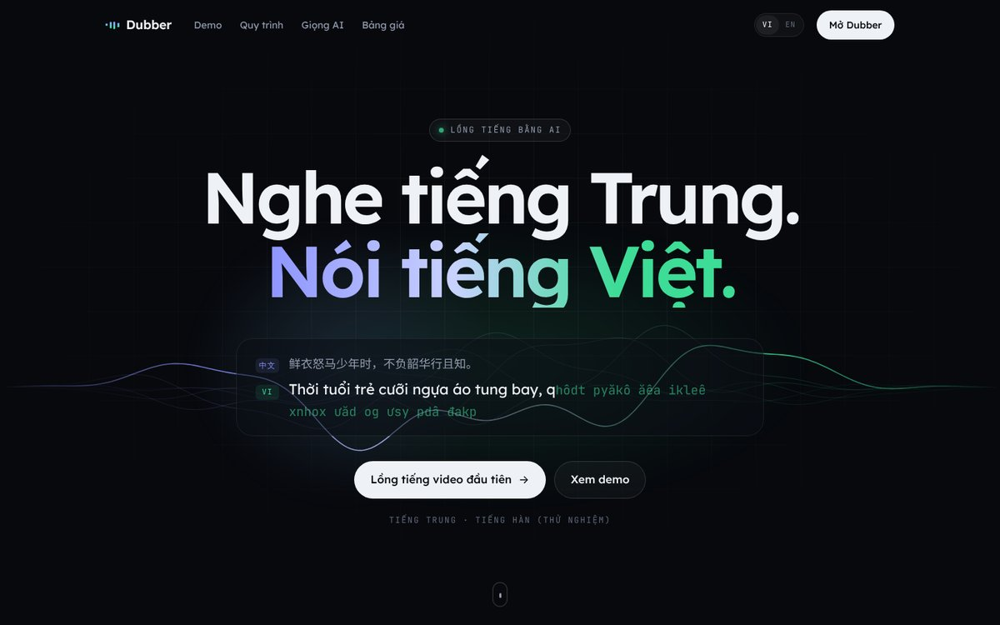
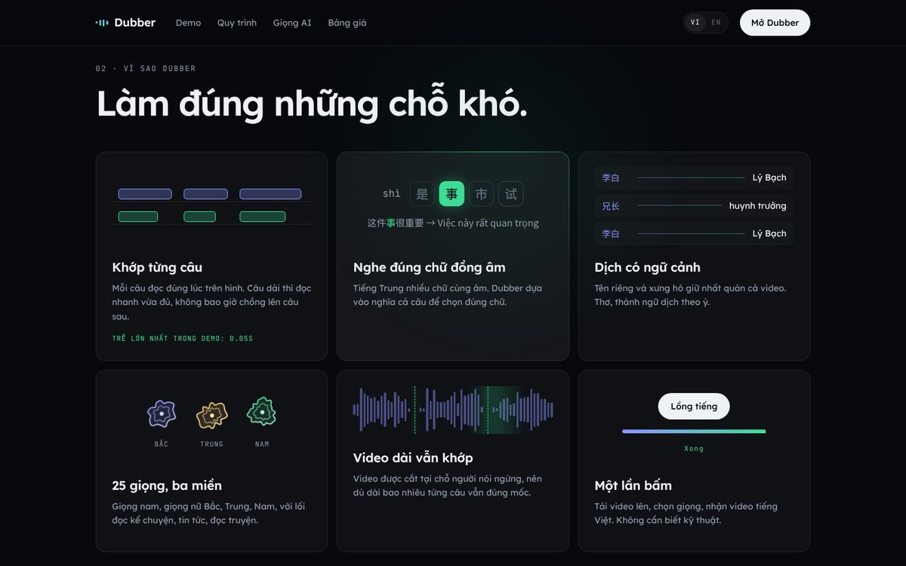
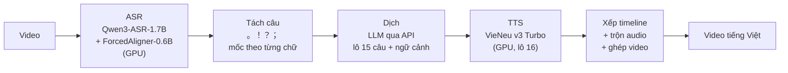

# Dubber

**Lồng tiếng Việt cho video tiếng Trung bằng AI, khớp từng câu với hình.**

*AI video dubbing from Chinese to Vietnamese: Qwen3-ASR + LLM translation + VieNeu TTS on GPU, every line synced to the picture.*



Đưa vào một video tiếng Trung (một người kể chuyện, kiểu video recap), nhận lại video đã lồng tiếng Việt:
mỗi câu được đọc đúng lúc trên hình, câu dài thì đọc nhanh vừa đủ, không bao giờ chồng lên câu sau.
Chạy hoàn toàn trên một máy có GPU 6 GB, có giao diện web và có thể chia sẻ qua link cho người khác dùng thử.

> Dự án cá nhân, đang ở giai đoạn thử nghiệm. Đích xa là một "studio" sửa được từng câu rồi render lại.

---

## Mục lục

- [Tính năng](#tính-năng)
- [Cách hoạt động](#cách-hoạt-động)
- [Số đo thật](#số-đo-thật)
- [Yêu cầu](#yêu-cầu)
- [Cài đặt](#cài-đặt)
- [Sử dụng](#sử-dụng)
- [Cấu trúc thư mục](#cấu-trúc-thư-mục)
- [Kiểm thử](#kiểm-thử)
- [Giới hạn hiện tại](#giới-hạn-hiện-tại)
- [Lộ trình](#lộ-trình)
- [Model và giấy phép](#model-và-giấy-phép)
- [Tác giả](#tác-giả)

---

## Tính năng

- **Nghe đúng tiếng Trung**: Qwen3-ASR phân biệt chữ đồng âm dựa vào nghĩa cả câu; ForcedAligner gán mốc thời gian
  cho từng chữ.
- **Video dài vẫn khớp**: audio được cắt ở chỗ người nói ngừng (đoạn tối đa 30 giây), nên mốc thời gian không bị dồn
  lệch dù video dài bao nhiêu.
- **Dịch có ngữ cảnh**: dịch theo lô 15 câu, kèm các câu vừa dịch trước đó để giữ xưng hô; thơ, thành ngữ dịch theo ý.
  Dùng LLM qua API kiểu OpenAI (hiện là Gemini), thử lại thông minh theo loại lỗi, chạy tiếp được chỗ dở.
- **25 giọng đọc tiếng Việt** (VieNeu-TTS v3 Turbo): nam, nữ, ba miền, các lối kể chuyện, tin tức, đọc truyện.
  TTS chạy **GPU, đọc theo lô**.
- **Xếp câu lên timeline không chồng giọng**: câu dài được tăng tốc tối đa 1.3 lần, vẫn tràn thì đẩy câu sau lùi lại.
- **Web chạy trên máy**:
  - trang giới thiệu song ngữ VI/EN (trang tĩnh, có demo dạng phòng dựng, phổ âm thật, timeline hai track);
  - trang làm việc: tải video, xem tiến độ từng bước, ước tính thời gian còn lại, bảng lời thoại song ngữ, so sánh
    bản gốc với bản Việt.
- **Chia sẻ bằng một lệnh** qua Cloudflare Quick Tunnel: không cần tài khoản hay tên miền, không mở cổng router.
- **Người dùng không thấy log hay lỗi kỹ thuật**: lỗi được đổi thành câu dễ hiểu, log thô chỉ nằm trên máy chủ.



## Cách hoạt động



- Mỗi bước chạy trong **một tiến trình riêng**, nạp model rồi nhả VRAM khi xong, vì GPU 6 GB không giữ nổi mọi model
  cùng lúc.
- Các bước giao nhau qua một file duy nhất, `segments.json` (schema `segments/v0`): câu gốc, câu dịch, mốc thời gian,
  file giọng, kế hoạch phát. Bước nào đã xong thì được giữ lại, chạy lại chỉ làm phần còn thiếu.
- Âm thanh trung gian là WAV, trộn bằng numpy, chỉ mã hoá một lần khi xuất video.

## Số đo thật

Đo trên máy của tác giả: RTX A3000 Laptop 6 GB, i9-11950H, RAM 30 GB, Ubuntu 22.04.

| Đo gì | Kết quả | Ngày |
|---|---|---|
| ASR, video 10 phút (608 giây) | 24 đoạn, VRAM torch đỉnh 4481 MiB, RTF ~0.08 | 2026-10-29 |
| Qwen3-ASR so với Whisper large-v3 | Qwen3 đúng cả 7/7 chỗ hai model nghe khác nhau (chủ yếu chữ đồng âm) | 2026-10-29 |
| Khớp thời gian, video 10 phút | 125 câu, câu Việt bắt đầu trễ nhất 0.84 giây so với câu gốc | 2026-10-29 |
| TTS, 24 câu (68 giây giọng), CPU ONNX int8 | 51.5 giây, chiếm ~14 nhân CPU | 2026-10-30 |
| TTS, cùng 24 câu, GPU lô 1 / 4 / 8 / 16 | 8.2 / 3.2 / 2.4 / **1.8 giây**, 1 nhân CPU, VRAM đỉnh 505–856 MiB | 2026-10-30 |
| TTS, video 10 phút (125 câu, 310 giây giọng), GPU lô 16 | nạp 5.4 giây + đọc 9.3 giây (RTF 0.03) | 2026-10-30 |

Công cụ đo nằm trong `tools/` (`bench_asr.py`, `bench_tts.py`, `check_asr_times.py`), có thể chạy lại.

## Yêu cầu

- Linux (đã chạy trên Ubuntu 22.04), GPU NVIDIA hỗ trợ bf16 (Ampere trở lên), từ 6 GB VRAM.
- Driver NVIDIA hỗ trợ CUDA 12 (máy tác giả: 535, CUDA 12.2; torch cu126 chạy được nhờ minor version compatibility).
- [Miniconda](https://docs.anaconda.com/miniconda/). Mọi thư viện cài trong env conda, không đụng hệ thống.
- Một API key LLM có endpoint tương thích OpenAI. Mặc định: [Gemini](https://aistudio.google.com) (có gói miễn phí).
- Ổ cứng: vài GB cho model (tải tự động lần chạy đầu).

## Cài đặt

Dự án dùng **ba env conda**, vì stack ASR (torch) và stack TTS/web xung đột phiên bản. Danh sách gói chính xác
của từng env nằm trong `envs/`.

```bash
git clone git@github.com:maixuanthuan/dubber_vid.git
cd dubber_vid

# 1. dub_asr: ASR trên GPU
conda create -n dub_asr python=3.12 -y
conda install -n dub_asr -c conda-forge ffmpeg -y
conda run -n dub_asr pip install -r envs/dub_asr.txt --extra-index-url https://download.pytorch.org/whl/cu126

# 2. dub_tts: dịch, web, ghép video
conda create -n dub_tts python=3.12 -y
conda install -n dub_tts -c conda-forge ffmpeg -y
conda run -n dub_tts pip install -r envs/dub_tts.txt flask pytest

# 3. dub_tts_gpu: TTS trên GPU (nhân bản dub_asr, thêm VieNeu)
conda create -n dub_tts_gpu --clone dub_asr -y
conda run -n dub_tts_gpu pip install vieneu==3.8.3 safetensors

# Key cho bước dịch
cp .env.example .env    # rồi điền GEMINI_API_KEY
```

Kiểm tra nhanh: `conda run -n dub_asr python tools/check_torch.py` (chạy thật các phép tính fp32/fp16/bf16 trên GPU,
so với CPU) và
`conda run -n dub_tts python tools/llm_check.py configs/translator_gemini.json` (key, model, dịch thử một câu).

> Ghi chú: các env trên máy tác giả được dựng dần bằng tay; script dựng env tự động đang nằm trong lộ trình.
> Nếu gặp lỗi `External data path escapes model directory` khi nạp VieNeu bản CPU, chạy
> `conda run -n dub_tts python tools/hf_materialize.py --apply`.

## Sử dụng

### Lồng tiếng một video bằng một lệnh

```bash
bash tools/dub.sh data/samples/video.mp4 zh configs/translator_gemini.json
bash tools/dub.sh data/samples/video.mp4 zh configs/translator_gemini_flash.json "Ngọc Huyền"   # chọn giọng
```

Kết quả nằm ở `data/projects/<tên video>__<tên config>/`: video `<tên>_vi.mp4`, `segments.json` và `report.md`
(báo cáo cho người phát triển: tỉ lệ thời lượng từng câu, tốc độ đọc, độ trễ).

| Config dịch | Model | Ghi chú |
|---|---|---|
| `configs/translator_gemini.json` | gemini-3.5-flash-lite | Mặc định, nhanh, gói miễn phí nhiều lượt |
| `configs/translator_gemini_flash.json` | gemini-3.6-flash | Dịch thơ, thành ngữ tốt hơn rõ; gói miễn phí ít lượt |

Quay TTS về CPU: đặt `TTS_DEVICE=cpu` ở đầu `tools/dub.sh`.

### Web trên máy

```bash
bash tools/web.sh
```

- `http://127.0.0.1:7860`: trang giới thiệu (`/?lang=en` cho bản tiếng Anh).
- `http://127.0.0.1:7860/app`: trang làm việc.

Chọn video ví dụ cho trang giới thiệu (sau khi đã lồng tiếng video đó):

```bash
conda run -n dub_tts python tools/set_demo.py --video data/samples/video.mp4 --project data/projects/video__translator_gemini
```

### Chia sẻ cho người khác dùng thử

```bash
bash tools/share.sh
```

Lệnh tự bật web ở chế độ chia sẻ (video tối đa 10 phút, chỉ dùng Flash-Lite) và mở một link
`https://….trycloudflare.com`. `Ctrl+C` là tắt cả web và link.

- Cần `cloudflared` trong `~/.local/bin`. Nếu thiếu, lệnh in sẵn câu lệnh tải.
- Đặt `DUBBER_ACCESS_CODE` trong `.env` nếu muốn bắt người vào nhập mã mời. Để trống thì ai có link cũng vào được.
- Máy phải bật trong lúc người khác dùng. Mỗi lần chạy lại thì link sẽ khác.

### Deploy lên Modal (đã chuẩn bị, chưa chạy)

`deploy/modal_app.py` đưa toàn bộ lên [Modal](https://modal.com): ASR trên GPU L4, web và TTS trên CPU,
dữ liệu trong một Volume. Cần tài khoản Modal **có gắn phương thức thanh toán** (Modal yêu cầu khi dùng GPU).

```bash
modal run deploy/modal_app.py      # kiểm hai image: GPU, bf16, ffmpeg, đọc thử một câu
modal deploy deploy/modal_app.py   # deploy, in ra link web
```

## Cấu trúc thư mục

```
dubber/            Lõi pipeline
  asr.py             ASR + gán mốc thời gian, cắt đoạn ở chỗ lặng, có cache
  translate.py       Dịch qua LLM: lô, ngữ cảnh, phân loại lỗi, thử lại
  v0.py              Các stage segment / translate / tts / mix và hàm thuần (tách câu, xếp timeline, báo cáo)
web/               Web Flask một file
  app.py             Hàng đợi job, API, chế độ chia sẻ (giới hạn video, mã mời tuỳ chọn)
  landing.html       Trang giới thiệu tĩnh, song ngữ (chữ nằm trong một bảng JSON)
  index.html         Trang làm việc
configs/           Cấu hình dịch (model, lô, thời gian chờ, số lần thử lại)
tools/             Lệnh vận hành và công cụ đo
  dub.sh             Chạy cả pipeline cho một video
  web.sh, share.sh   Mở web trên máy / chia sẻ qua Cloudflare Tunnel
  bench_*.py         Đo ASR, TTS trên dữ liệu thật
  set_demo.py        Chọn video ví dụ cho trang giới thiệu
  apply_pkg.sh       Áp một gói thay đổi (có kiểm md5, sao lưu)
deploy/            Bản deploy lên Modal
tests/             Kiểm thử (pytest), không cần GPU, model hay mạng
envs/              Danh sách gói của các env conda
docs/              Tài liệu: bối cảnh dự án, cách làm việc, ảnh
data/              (không đưa lên git) video, cache ASR, kết quả, job
```

## Kiểm thử

```bash
conda run -n dub_tts env PYTHONDONTWRITEBYTECODE=1 python -m pytest -q -p no:cacheprovider tests
```

Bộ test chạy trong vài giây, không cần GPU, model hay mạng: phần quyết định (tách câu, xếp timeline, phân loại lỗi
API, đọc tiến độ từ log…) viết thành hàm thuần; phần web chạy với một lệnh lồng tiếng giả. Mỗi test ghi rõ ba điều:
tình huống thật, phần giả lập, và người dùng gặp hậu quả gì nếu test đỏ.

## Giới hạn hiện tại

- Nội dung **một người kể**. Nhiều nhân vật, nhiều giọng chưa hỗ trợ.
- Âm thanh gốc chỉ được hạ nhỏ (12%), chưa tách giọng khỏi nhạc nền.
- Ngôn ngữ nguồn: tiếng Trung. Tiếng Hàn có trong lựa chọn nhưng **chưa thử trên video thật**.
- Bản dịch Flash-Lite đôi khi **không giữ tên riêng nhất quán** trong cả video (ví dụ một nhân vật lúc "Jaian"
  lúc "Chaien"). Đang tìm cách sửa.
- Chưa sửa được từng câu trên giao diện; muốn sửa thì sửa `segments.json` rồi chạy lại.
- Web xử lý **một video một lúc**, video sau xếp hàng.

## Lộ trình

- [ ] Giữ tên riêng nhất quán khi dịch (bảng tên riêng cho cả video)
- [ ] Tiếng Hàn chính thức; thêm ngôn ngữ nguồn qua một bảng cấu hình (tiếng Anh, tiếng Nhật…)
- [ ] Sửa từng câu và render lại câu đó (hướng "studio")
- [ ] Nghe thử giọng trước khi chọn
- [ ] Script dựng env tự động
- [ ] Phân quyền quản trị / khách, thu log lỗi cho quản trị

## Model và giấy phép

| Thành phần | Dùng cho | Giấy phép |
|---|---|---|
| [Qwen3-ASR-1.7B](https://huggingface.co/Qwen/Qwen3-ASR-1.7B), [Qwen3-ForcedAligner-0.6B](https://huggingface.co/Qwen/Qwen3-ForcedAligner-0.6B) | Nhận dạng lời nói, gán mốc thời gian | Apache 2.0 |
| [VieNeu-TTS v3 Turbo](https://huggingface.co/pnnbao-ump/VieNeu-TTS-v3-Turbo) | Đọc tiếng Việt | Code Apache 2.0; **giấy phép weight cần kiểm tra trước khi dùng thương mại** |
| [MOSS-Audio-Tokenizer-Nano](https://huggingface.co/OpenMOSS-Team/MOSS-Audio-Tokenizer-Nano) | Codec âm thanh của VieNeu (đường GPU) | Theo model card |
| Gemini API | Dịch | Theo điều khoản của Google |

Model được tải tự động từ Hugging Face lần chạy đầu và **không nằm trong repo**. Video đem vào xử lý thuộc bản quyền
của chủ sở hữu; repo không chứa video nào.

Mã nguồn của repo này hiện **chưa gắn giấy phép mã nguồn mở**: mọi quyền thuộc tác giả.

## Tác giả

**@maixuanthuan**

Tài liệu nội bộ của dự án (bối cảnh, quyết định và lý do, số đo, việc còn lại) nằm trong
[`docs/CONTEXT_DUBBER.md`](docs/CONTEXT_DUBBER.md).